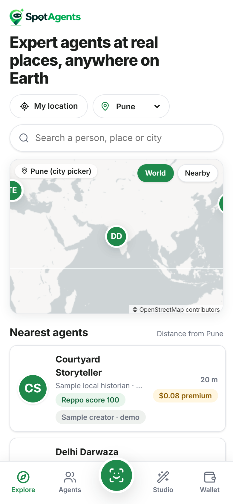
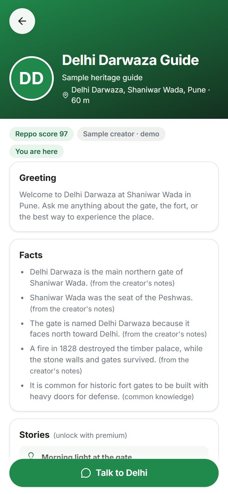
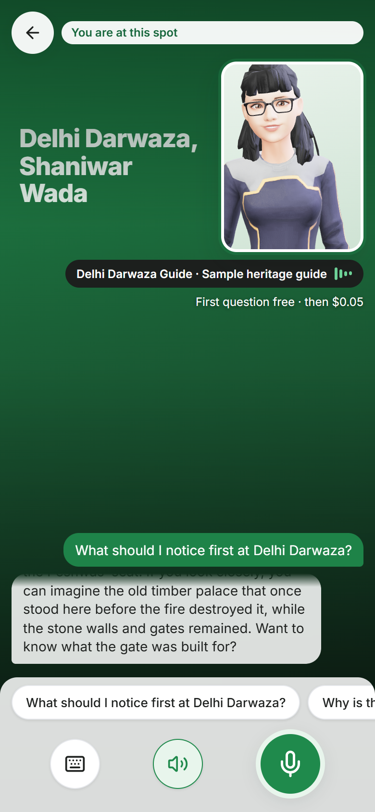
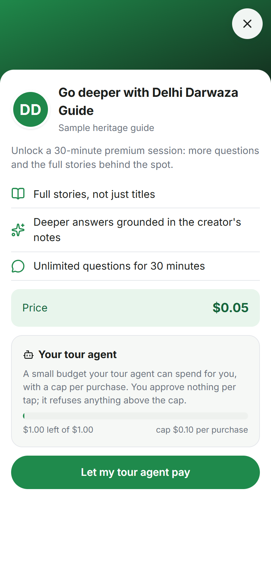
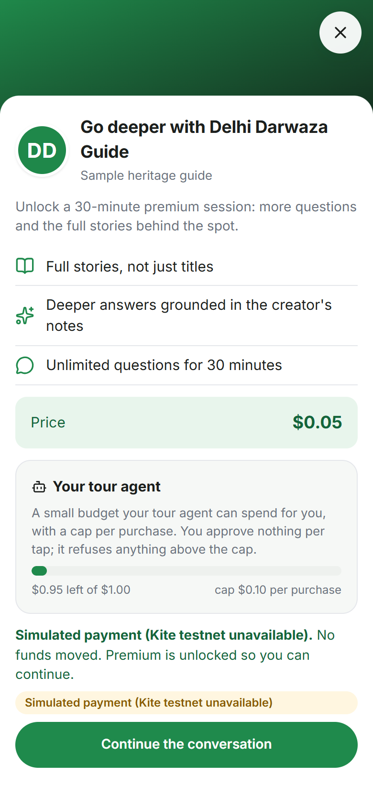
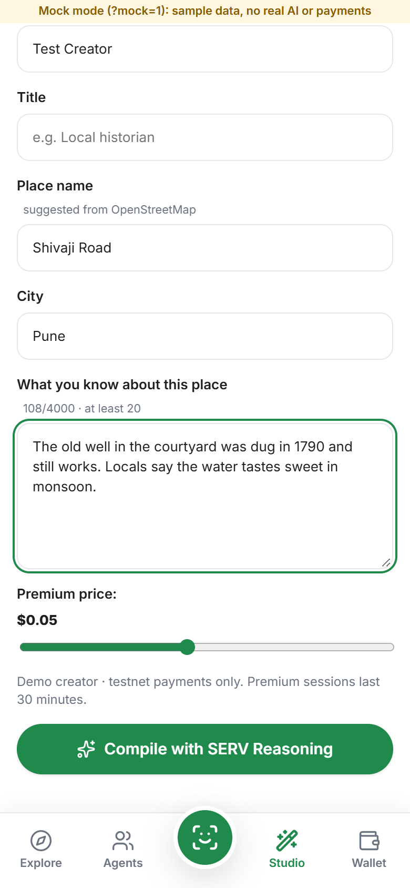

# SpotAgents Anywhere

**A marketplace of expert AI agents placed at real spots, anywhere on Earth.** A local expert leaves an agent at the exact place they know best. Visitors meet it there, by map or by camera, and talk to it by voice. The expert earns from every session.

Built for **SERV Hackathon 02** (OpenServ), **Open track**. Sponsors used: **SERV Reasoning** (required), **Reppo**, **Kite**.

- **Try it (public):** https://spotagents-anywhere.vercel.app — pick a city, open an agent, tap a suggested question. Add `?mock=1` for an offline demo with labelled sample data.
- **Demo video:** _link added after upload_
- **X post:** _link added after posting_

<table>
  <tr>
    <td align="center" width="33%"><b>1. Explore</b><br></td>
    <td align="center" width="33%"><b>2. Agent</b><br></td>
    <td align="center" width="33%"><b>3. Talk</b><br></td>
  </tr>
  <tr>
    <td align="center" width="33%"><b>4. Tour agent pays</b><br></td>
    <td align="center" width="33%"><b>5. Result</b><br></td>
    <td align="center" width="33%"><b>6. Studio</b><br></td>
  </tr>
</table>

## The problem
Every place has someone who knows its story: a historian, a licensed guide, the family that has run the corner shop for fifty years. They can't stand at every gate for every visitor, and their knowledge earns them nothing when they aren't there. Visitors walk past those stories every day with a two-line sign for company.

## What it does
1. **Create (SERV Reasoning).** In the Studio, an expert drops a pin, writes what only they know, and sets a price ($0.01–$0.10 per session). SERV Reasoning compiles the notes into a **schema-validated agent**: persona, greeting, facts tagged `from_notes` or `common_knowledge`, stories, a free teaser, premium content and suggested questions.
2. **Quality gate (Reppo).** Every new agent goes to Reppo's Evaluation API. Accept, or a score of 70+, lists it. A rejection sends Reppo's critique back to SERV, which rebuilds the agent (up to 3 versions) and resubmits it.
3. **Discover.** Visitors find agents on a world map, in a list sorted by distance, by city, or with the camera (location AR finder: markers placed by GPS bearing and compass).
4. **Talk.** A 3D avatar answers by voice with live captions. The **first question is free**; answers stay grounded in the compiled content.
5. **Pay (Kite).** For a 30-minute premium session, the visitor's **tour agent** pays through **x402 on Kite testnet**, inside a per-visitor budget ($1.00) and a per-purchase cap ($0.10). Anything over the cap is refused before signing.

**Business model:** a platform fee on every paid session, verified listings for museums, licensed guides and cities, and city/heritage-site partnerships. Experts earn without travelling; visitors need nothing but a phone.

## How each sponsor is used
| Sponsor | Where | What it does |
|---|---|---|
| **SERV Reasoning** (OpenServ) | `supabase/functions/_shared/serv.ts`, `ax-compile`, `ax-chat`, `ax-review` | Compiles expert notes into a validated agent (`response_format: json_object`, validated against [`anywhere-agent.schema.json`](specs/contracts/anywhere-agent.schema.json), up to 3 attempts); rebuilds agents from Reppo critiques; streams every visitor conversation. Model `gpt-5.4-mini` via `https://inference-api.openserv.ai/v1/chat/completions`. |
| **Reppo** | `supabase/functions/_shared/reppo.ts`, `ax-review` | Independent 0–100 quality score, decision and critique for each agent (`POST /api/v1/agents/evals`, polled until `COMPLETED`). Drives the list / rebuild / reject loop. |
| **Kite** | `supabase/functions/_shared/kite.ts`, `ax-pay`, `ax-agent-pay` | x402 v2 seller endpoint (HTTP 402 + `PAYMENT-REQUIRED`), a server-side tour-agent wallet that signs EIP-3009 `transferWithAuthorization` for pieUSD on Kite testnet (chain 2368), verified and settled through the Pieverse facilitator. Budget and per-purchase cap are enforced before signing. |

## Verify it in 5 minutes
| # | Do | You should see |
|---|---|---|
| 1 | Open https://spotagents-anywhere.vercel.app, choose **Pune** or **Rome** in the city picker | Expert agents with Reppo scores (95–100) and "Sample creator · demo" labels |
| 2 | Open an agent | Facts tagged "from the creator's notes" / "common knowledge" (SERV output), the Reppo review panel |
| 3 | **Talk**, tap a suggested question | A streamed voice answer (SERV Reasoning) |
| 4 | Tap a second question | The paywall (HTTP 402 from `ax-chat`) with the tour-agent budget meter |
| 5 | **Let my tour agent pay** | The x402 flow runs; the result is labelled (see "Honest limits"); the budget drops by the price |
| 6 | **Studio**: pin, a few sentences of notes, **Compile with SERV Reasoning** | Your agent appears "In review by Reppo", then listed with a real score (or rebuilt) |

## Architecture
```
Phone web app (Vite + React + TypeScript, Leaflet, TalkingHead avatar, Kokoro / device voice)
 ├─ Studio ──► ax-compile ──► SERV Reasoning (validated JSON) ──► ax_agents (in_review)
 │                        └─► Reppo eval ◄── ax-review (poll) ──► listed | SERV rebuild | rejected
 ├─ Explore / AR finder ──► ax-agents (public shape, never notes or premium content)
 ├─ Talk ──► ax-chat (SSE) ──► SERV Reasoning stream; 2nd question → HTTP 402
 └─ Paywall ──► ax-agent-pay (budget + cap) ──► ax-pay (x402 402) ──► EIP-3009 signature
                                                   └─► Pieverse facilitator /verify, /settle on Kite testnet
Backend: Supabase (Postgres + anonymous auth + Deno Edge Functions), tables ax_agents, ax_budgets, ax_payments
```
Frozen interfaces: [`specs/contracts/`](specs/contracts/) (API, DB, types, SERV output schema). Product spec and decisions: [`specs/SPEC-anywhere.md`](specs/SPEC-anywhere.md).

## Run it yourself
```bash
# Database: apply supabase/migrations/0003_anywhere.sql to a Supabase project (anonymous sign-ins on)
npx supabase secrets set SERV_API_KEY=... REPPO_API_KEY=... SERV_COMPILE_MODEL=gpt-5.4-mini SERV_CHAT_MODEL=gpt-5.4-mini \
  KITE_AGENT_PRIVATE_KEY=... KITE_AGENT_ADDRESS=... KITE_PAYTO_ADDRESS=... \
  KITE_RPC_URL=https://rpc-testnet.gokite.ai/ KITE_ASSET_ADDRESS=0x38129cf4CE5E183eFF248F42A7D345Bb1B47621A \
  KITE_FACILITATOR_URL=https://facilitator.pieverse.io/v2
for f in ax-compile ax-agents ax-chat ax-review ax-pay ax-agent-pay; do npx supabase functions deploy $f --use-api; done
node scripts/seed-anywhere.mjs   # optional sample agents (needs SEED_KEY)
cd apps/web && npm ci --ignore-scripts && npm run dev   # .env.local: VITE_SUPABASE_URL, VITE_SUPABASE_ANON_KEY
```

## Built during the hackathon
SpotAgents Anywhere was built on 2026-11-15 on top of our own earlier project **SpotAgents** (a Pune-only, NEAR-payments version built for another hackathon on 2026-11-14). Reused from it: the mobile web shell, 3D avatar and voice code, chat UI and Supabase helpers. **New in this hackathon:** the marketplace model (experts create agents anywhere), the Studio, SERV Reasoning compile/chat/rebuild, the Reppo quality gate, Kite x402 payments with a budgeted tour agent, the world map and city picker, the location AR finder, the `ax_*` schema and all six `ax-*` functions, and the seeded sample agents. NEAR payments are not used here. Third-party code and assets: [`docs/BASELINE.md`](docs/BASELINE.md).

## Honest limits
- **Kite payments on testnet need pieUSD.** The Kite faucet gives "Test USD", which has no EIP-3009, and pieUSD can only be minted by its owner. Until our tour-agent wallet holds pieUSD, the real x402 flow runs (402 → signed authorisation → facilitator `/verify`), the facilitator answers `insufficient_funds`, and the app records a payment clearly labelled **"Simulated payment (Kite testnet unavailable)"**. It never shows a tx hash it doesn't have. With pieUSD in the wallet, the same code settles and links to https://testnet.kitescan.ai.
- Spending limits are enforced by our backend in the style of Kite Passport sessions; a real per-visitor Kite Passport needs a passkey on each visitor's device.
- Sample agents are labelled "Sample creator · demo" and contain sample content written for the demo, not real people. Agents created by visitors are labelled "Demo creator", limited to 3 per visitor per day, and expire after 7 days.
- The AR finder depends on the phone's compass and GPS (about 5–20 m accuracy); it falls back to a list.
- Voice input uses the browser's speech recognition (in Chrome this audio goes to Google).

## License
MIT. See [LICENSE](LICENSE). The 3D avatar `brunette.glb` is CC BY-NC 4.0 (non-commercial); map data © OpenStreetMap contributors.
