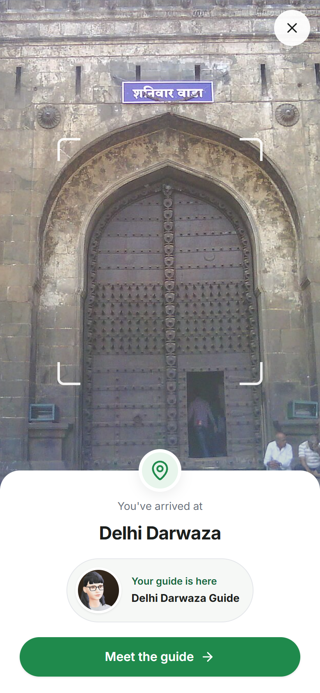
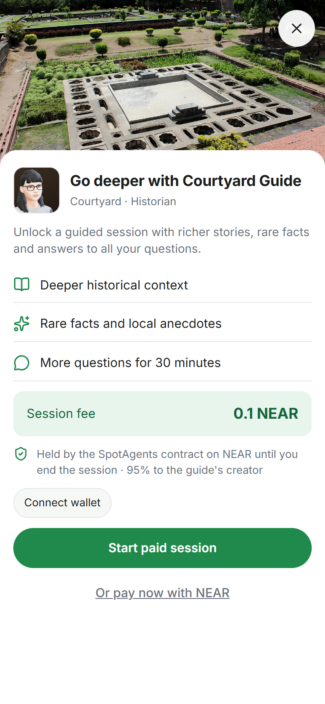
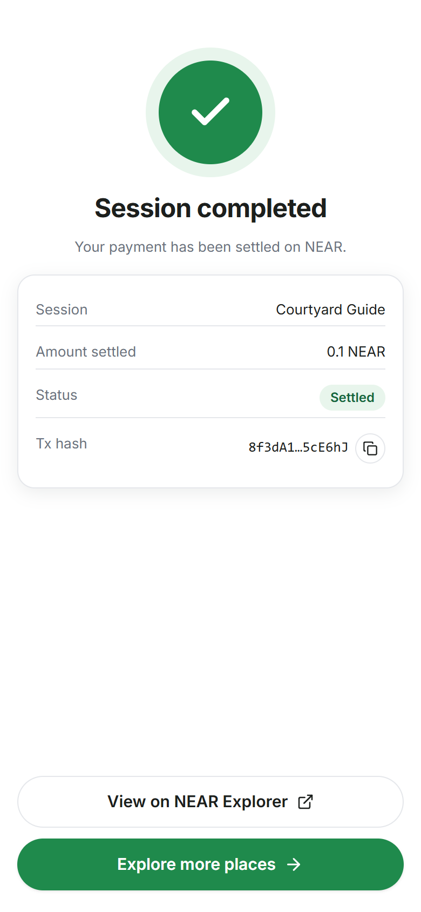
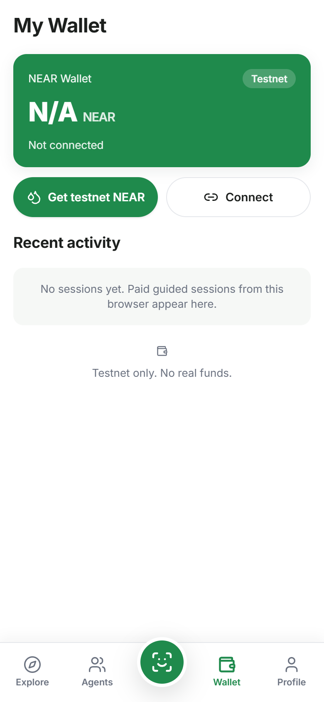

# SpotAgents

[](https://github.com/pradeepmisal/Spot-Agents/actions/workflows/ci.yml)

**AI guides that live at real places. Walk up to a monument, its guide appears and talks to you, and the local expert who created it is paid in NEAR when your session ends.**

Built at **NEAR HACKATHON 2026** (Nov 1–14). Tracks: `realworld`, `agents`, `open`.

- **Website:** https://spotagents-near.vercel.app
- **Demo video (3:06):** https://youtu.be/wPhySWllJ1M
- **Demo post on X:** https://x.com/Pradeep_misal_/status/2121707238612181327
- **Contract (NEAR testnet):** [`spotpayv2.sweetfrog-treasury.testnet`](https://testnet.nearblocks.io/address/spotpayv2.sweetfrog-treasury.testnet) (escrow sessions). The v1 contract `spotpay.sweetfrog-treasury.testnet` (instant pay) is kept for compatibility.

## Demo video (3 min)
[](https://youtu.be/wPhySWllJ1M)

Click to watch on YouTube, or [play the MP4 directly](https://spotagents-near.vercel.app/video/spotagents-demo.mp4).

<table>
  <tr>
    <td align="center" width="33%"><b>1. Explore</b><br></td>
    <td align="center" width="33%"><b>2. Arrive</b><br></td>
    <td align="center" width="33%"><b>3. Converse</b><br></td>
  </tr>
  <tr>
    <td align="center" width="33%"><b>4. Go deeper</b><br></td>
    <td align="center" width="33%"><b>5. Settle</b><br></td>
    <td align="center" width="33%"><b>6. Wallet</b><br></td>
  </tr>
</table>

## Verify it in 5 minutes
No accounts or keys needed for steps 1–3.

| # | Do | You should see |
|---|---|---|
| 1 | `cd contract && cargo test` (Rust stable) | `test result: ok. 20 passed`: fee maths, escrow start, release by payer, release by anyone after 30 min, double-release and wrong-caller rejections |
| 2 | Read the live escrow record on testnet:<br>`curl -s https://test.rpc.fastnear.com -H 'Content-Type: application/json' -d '{"jsonrpc":"2.0","id":1,"method":"query","params":{"request_type":"call_function","finality":"final","account_id":"spotpayv2.sweetfrog-treasury.testnet","method_name":"get_session","args_base64":"eyJxdW90ZV9pZCI6InFfMEZ5amp3ZjYxY0FRUXUyZ0wyQ2IifQ=="}}'`<br>(args = `{"quote_id":"q_0Fyjjwf61cAQQu2gL2Cb"}`; the `result` bytes are JSON) | `"amount":"100000000000000000000000"` (0.1 NEAR), `"fee":"5000000000000000000000"` (5%), `"status":"released"`, payer and creator accounts |
| 3 | `cd apps/web && npm ci --ignore-scripts && npm run build && npx vite preview`, then open `http://localhost:4173/?mock=1` in a phone-sized window and tap **Virtual visit** → **Next** | The map, the virtual walk over real photos of Shaniwar Wada, a guide appearing when a spot is reached. `?mock=1` uses sample guides and labelled sample replies, so no backend is needed |
| 4 | Open the two transactions in [Verified on testnet](#verified-on-testnet-2026-11-14) | `start_session` holding 0.1 NEAR, then `release` paying 0.095 to the creator and 0.005 to the treasury in one receipt |
| 5 | Full stack with live AI and wallet: follow [Run it yourself](#run-it-yourself) | Real answers from NEAR AI Cloud, the paywall, and Meteor Wallet signing `start_session` / `release` |

## The problem
At heritage sites like Shaniwar Wada in Pune, visitors walk past places they know nothing about. Human guides are expensive, often speak only one language and aren't there at 7 pm. Signboards are short. The historians and local guides who know each spot best have no simple way to earn from that knowledge when they aren't physically present, and many have no card-payment account.

## What SpotAgents does
1. **Discover.** A map shows every spot at the monument and the guide waiting there.
2. **Arrive.** Each spot (gate, drum house, courtyard, ruins, fountain) has a guide with a radius. When your GPS, or the virtual walk, enters it, the guide appears, waves and greets you aloud.
3. **Converse.** The first question is free. You talk by voice or text, and the guide answers by voice with live captions. The landmark fills the screen, with the 3D guide (lip-synced) in a portrait window and the reply highlighted as it is spoken.
4. **Go deeper.** To continue, start a guided session: **0.1 NEAR is held in escrow** by the `spot_pay` contract.
5. **Settle.** When you end the session, the contract pays **95% to the guide's creator and 5% to the platform** in one transaction. If you forget, anyone can release it after 30 minutes.
6. **Wallet.** Your testnet balance and every session with its on-chain status.

**How NEAR fits in:**
- **Escrowed micropayments to local experts** with no payment processor, split on chain by our own contract.
- **Private, verifiable inference:** guides run on **NEAR AI Cloud** with a model inside a secure hardware enclave (TEE).
- **A real wallet connection** through NEAR Connect and Meteor Wallet.

### NEAR integrations used
| Integration | Role in SpotAgents |
|---|---|
| **NEAR AI Cloud** | Guide answers from a verifiable model (`z-ai/glm-5.3-flash`) running in a TEE; OpenAI-compatible API, streamed |
| **`spot_pay` smart contract** (Rust, near-sdk 5.30.2, cargo-near) | Escrow: `start_session` holds the deposit, `release` splits it 95/5 in one call; NEP-297 events; `get_session` / `get_payment` views |
| **NEAR Connect + Meteor Wallet** | Tourist connects a wallet and signs `start_session` / `release` |
| **near-api-js** | Builds and sends the function-call transactions |
| **NEAR RPC** (FastNEAR testnet) | Backend verifies sessions on chain before unlocking; wallet balances |
| **NEAR accounts** | Named accounts for guide creators and the treasury; the contract lives on a sub-account (created with near-cli-rs) |
| **NearBlocks** | Every payment links to its on-chain receipt |

### Where each feature lives
| Claim | Code |
|---|---|
| Escrow: `start_session` holds the deposit | [`contract/src/lib.rs` L228](contract/src/lib.rs#L228) |
| `release`: 95% creator / 5% platform in one call; anyone may release after 30 min | [L256](contract/src/lib.rs#L256), fee maths [L147](contract/src/lib.rs#L147), timeout [L46](contract/src/lib.rs#L46) |
| NEP-297 events (`EVENT_JSON`) | [L127](contract/src/lib.rs#L127) |
| Quote with expiry, stored server-side | [`supabase/functions/near-pay/quote.ts`](supabase/functions/near-pay/quote.ts#L14) |
| Backend reads the session on chain before unlocking (never trusts the client) | [`near-pay/verify.ts` L42](supabase/functions/near-pay/verify.ts#L42) |
| First question free, then HTTP 402 with a payment request | [`chat/index.ts` L95–L102](supabase/functions/chat/index.ts#L95) |
| Guide answers streamed from NEAR AI Cloud | [`chat/routing.ts`](supabase/functions/chat/routing.ts) |
| Wallet connect and transaction signing (NEAR Connect) | [`apps/web/src/near/wallet.tsx`](apps/web/src/near/wallet.tsx#L20), [`near/session.ts` L65, L83](apps/web/src/near/session.ts#L65) |
| Geofence: a guide appears when you enter its radius | [`apps/web/src/visit/useGeofence.ts`](apps/web/src/visit/useGeofence.ts) |
| Nearby guides without exposing coordinates or prompts | [`supabase/migrations/0001_agents.sql`](supabase/migrations/0001_agents.sql) (`nearby_agents()`) |
| Neural voice in the browser, with device-voice fallback | [`apps/web/src/voice/neuralVoice.ts`](apps/web/src/voice/neuralVoice.ts), [`chat/voice.ts`](apps/web/src/chat/voice.ts) |

**Next market:** small shops and street vendors. The same contract lets a chai stall put its own agent at its counter.

## Verified on testnet (2026-11-14)
| Step | Transaction | Result |
|---|---|---|
| `start_session` (0.1 NEAR held) | [`CXju2kvr…ZWUx`](https://testnet.nearblocks.io/txns/CXju2kvrhnp8BBptofgxyL3mjbak6D9KzZrKByR7ZWUx) | Contract balance +0.1 NEAR; backend `verify` returned `session_status: active` and the guide unlocked |
| `release` (by the tourist) | [`7Puq6qts…pg4uX`](https://testnet.nearblocks.io/txns/7Puq6qtsBYhgrYkMubecYiB5sghaJ9eXGZsYsB6pg4uX) | Creator +0.095 NEAR, treasury +0.005 NEAR, contract back to its starting balance |
| v1 `pay` (instant) | [`25C2iRWQ…GQak`](https://testnet.nearblocks.io/txns/25C2iRWQuruRFdqS7GH3W8nC2njZGYfpBFNKXTbBGQak) | Fee exactly 5% (0.005 NEAR) |

## Architecture
```
Phone browser (Vite + React)
 ├─ Explore map (Leaflet + OpenStreetMap), virtual visit or live camera ─ geofence ─► guide appears
 ├─ Guide: TalkingHead 3D avatar; Kokoro neural voice in the browser (falls back to the device voice)
 ├─ Chat (SSE) ───────────────►  Supabase Edge Function `chat` ──► NEAR AI Cloud (z-ai/glm-5.3-flash, TEE)
 ├─ Nearby guides ────────────►  Postgres `nearby_agents()` (never returns exact coordinates or prompts)
 └─ NEAR Connect + Meteor ─────►  spot_pay contract: start_session / release (escrow, 95/5 split)
                                  Edge Function `near-pay`: quote + on-chain verify (view `get_session`)
```
Paid answers unlock only after the backend reads the session record from the contract; the client's word is never trusted. Money is integer yoctoNEAR everywhere: `u128` in Rust, `bigint` in TypeScript, `numeric(40,0)` in SQL.

## Repository layout
| Path | What |
|---|---|
| `apps/web/` | Mobile web app (Vite, React, TypeScript) |
| `supabase/` | Database migrations, demo seed, Edge Functions `chat` and `near-pay` |
| `contract/` | Rust `spot_pay` contract (near-sdk 5.30.2), 20 unit tests |
| `site/` | The landing page at spotagents-near.vercel.app |
| `docs/` | Setup guide, design decisions (`docs/adr/`), third-party baseline, screenshots |
| `brand/` | Logo and icons |

## Run it yourself
You need a Supabase project, a NEAR AI Cloud API key, and NEAR testnet accounts.

```bash
# 1. Database: apply supabase/migrations/*.sql, then supabase/seed.sql (enable anonymous sign-ins)
# 2. Functions
npx supabase secrets set NEARAI_API_KEY=... NEARAI_MODEL=z-ai/glm-5.3-flash \
  NEAR_RPC_URL=https://test.rpc.fastnear.com SPOTPAY_CONTRACT_ID=<your contract account>
npx supabase functions deploy chat near-pay --use-api

# 3. Contract (Linux or WSL; Rust + cargo-near 0.23)
cd contract && cargo test && cargo near build non-reproducible-wasm
near contract deploy <account> use-file <wasm> with-init-call new \
  json-args '{"treasury":"<treasury.testnet>","fee_bps":500}' prepaid-gas '30 Tgas' attached-deposit '0 NEAR' \
  network-config testnet sign-with-keychain send

# 4. Web app
cd apps/web && npm ci --ignore-scripts && npm run dev
```
Copy `apps/web/.env.example` to `.env.local` and `supabase/functions/.env.example` for the function secrets. `apps/web/.env.local` needs `VITE_SUPABASE_URL`, `VITE_SUPABASE_ANON_KEY`, `VITE_SPOTPAY_CONTRACT_ID` and `VITE_NEAR_NETWORK=testnet`. `--ignore-scripts` skips a HeadTTS post-install step that fails on Windows. More detail is in [docs/SETUP.md](docs/SETUP.md).

## How it was built
SpotAgents was built spec-first with a team of Claude Code agents:
- **Specs and frozen interfaces first**, then a task plan.
- **Three builder agents in parallel** (web, backend, NEAR), each in its own git worktree and owning its own folders.
- **Decisions recorded as ADRs** in `docs/adr/README.md`.

## Credits
Third-party code, licences and asset credits are listed in [docs/BASELINE.md](docs/BASELINE.md). Built with help from Claude Code.

## Honest limits
- The virtual visit simulates **only the camera and GPS**; the AI, the avatar and the payments are real.
- The neural voice needs a phone GPU (WebGPU) to be fast. Other devices use the built-in voice automatically.
- Web GPS is accurate to about 5–20 m, so a guide appears within its area, not pinned to an exact stone.
- Voice input uses the browser's speech recognition (in Chrome this audio goes to Google). Typed questions go only to our backend and NEAR AI Cloud. On-device speech recognition is next.
- Testnet only. Refunds and disputes for escrow sessions are future work.

## License
MIT. See [LICENSE](LICENSE). Third-party assets keep their own licences.
